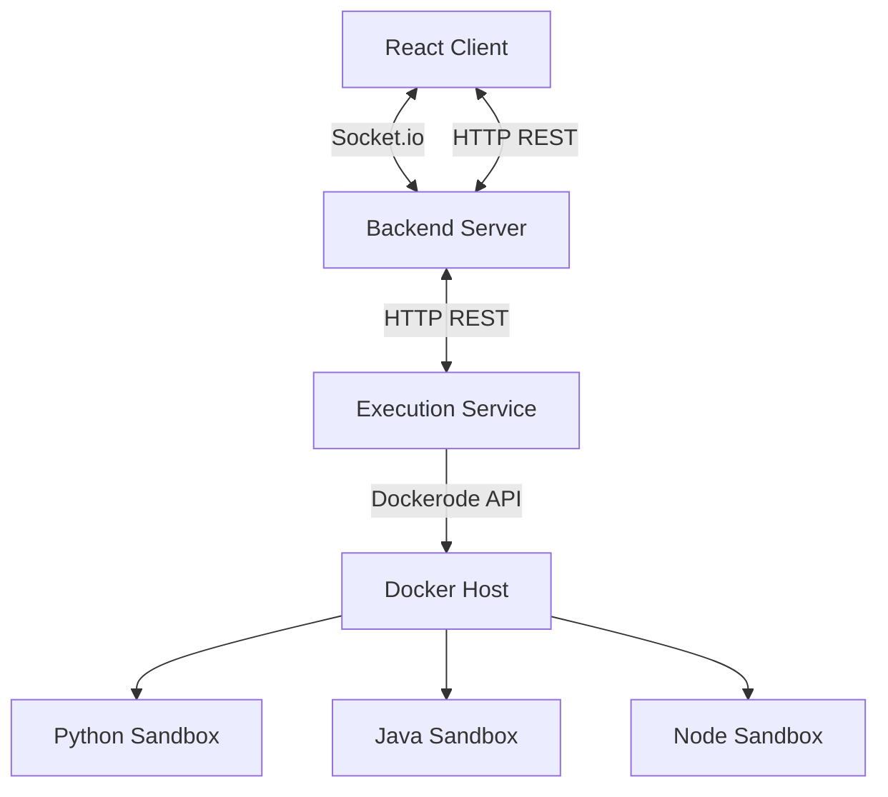

# Real-Time Collaborative Coding Platform

A powerful platform allowing multiple developers to write, edit, and execute code together in real-time.


## Features
- Real-time code collaboration
- Support for multiple languages (Java, Python, JavaScript)
- Secure, sandboxed code execution
- Real-time cursor tracking and presence
- Syntax highlighting and code formatting

## Tech Stack
- **Frontend**: React, Monaco Editor
- **Backend**: Node.js, Express, Socket.io
- **Execution Service**: Node.js, Dockerode
- **Containerization**: Docker

## Architecture


## Getting Started

### Prerequisites
- Node.js 18+
- Docker & Docker Compose

### Installation
1. Clone the repository
2. Run `npm install` in the respective directories (`client`, `server`, `execution-service`)
3. Build the runner images:
   ```bash
   docker build -t collab-python-runner ./docker/python
   docker build -t collab-java-runner ./docker/java
   docker build -t collab-node-runner ./docker/node
   ```

### Running
Run via Docker Compose:
```bash
cd docker
docker-compose up --build
```

## API Documentation

### Execution Service (`:3002`)
- `POST /execute`
  - Body: `{ "code": "string", "language": "string", "stdin": "string" }`
  - Response: `{ "output": "string", "error": "string", "executionTime": number, "exitCode": number }`
- `GET /health`
  - Response: `{ "status": "ok" }`

## Socket Events
- `join-room`: Join a collaboration room
- `code-change`: Broadcast code edits
- `cursor-move`: Broadcast cursor position
- `user-joined` / `user-left`: Presence notifications

## Docker Setup
The execution service uses Dockerode to spawn lightweight sandboxed containers. Ensure your Docker socket is mounted properly. On Windows, the socket is `//./pipe/docker_engine`. On Linux, it's `/var/run/docker.sock`. Update the `.env` or `docker-compose.yml` if needed.

## Project Structure
- `/client` - React frontend
- `/server` - Socket.io and main backend
- `/execution-service` - Code execution microservice
- `/docker` - Sandbox images and compose files

## Contributing
1. Fork the repo
2. Create your feature branch
3. Commit your changes
4. Push to the branch
5. Create a new Pull Request

## License
MIT License
